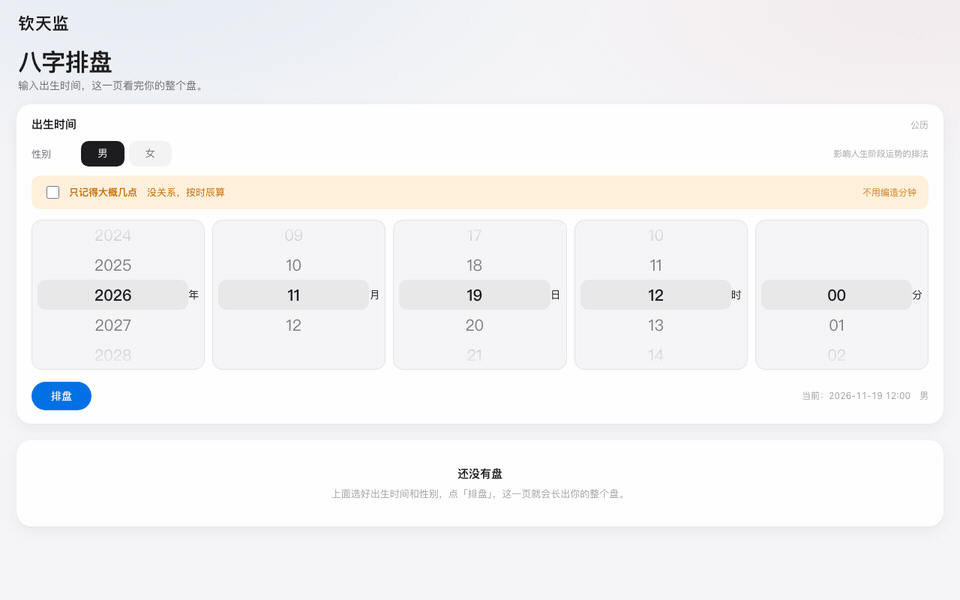

# 钦天监 · Qintianjian

[](https://github.com/y16689540962-cloud/qintianjian/actions/workflows/ci.yml)
[](LICENSE)

[English](README.en.md) · **简体中文**

**九术合一的中文术数 Agent Skill：排盘由零依赖 Python 算，不由模型猜；每条判断标出处等级；算不出来就直说。**

```bash
python3 scripts/xuan.py doctor                                   # 零依赖自检，10 秒
python3 scripts/bazi.py --solar 1990-05-15 --hour 12:00 --sex 男   # 四柱 / 大运 / 流年
```

`260` 条单元测试 · `34` 条端到端用例 · 证据与文件哈希在 [`evals/evidence/`](evals/evidence/) ·
历法 1850–2100 全量 `91,676` 天外部比对（7 个月首经 USNO 月相 API 仲裁）

> 边界：不判生死、不做疾病诊断、不判官司胜负、不给股价买卖点、不测胎儿性别、不替你做不可逆决定。

## 附带：客户界面

[`ui/`](ui/) 是本引擎的排盘界面——一页看完一张盘（结论 / 四柱 / 五行 / 大运 / 神煞 / 时间口径）。
零依赖，直接在仓库根跑：

```bash
python3 ui/serve.py 8901   # → http://127.0.0.1:8901/
```

界面只描述命盘结构，不做吉凶断论；传统流派说法明确标注「仅供参考」。详见 [`ui/README.md`](ui/README.md)。



---

## 1 · 这不是"又写了个算命 prompt"

市面上已有的六个术数 skill（奇门紫微、八字、姻缘、佛学、风水、塔罗）各自能用，但拼在一起会撞三种墙：
**历法口径各算各的**、**出处随口就来**、**多派结论打架没人裁**。本项目的做法是把这三件事工程化：

| 问题 | 上游常见做法 | 本项目 |
|---|---|---|
| 排盘 | 有的全靠模型心算，有的自带脚本 | **唯一事实源是脚本**，模型只能翻译，不许改盘 |
| 历法 | 各 skill 各自处理节气/子时/闰月 | 一套 `calendar_core.py`，全库同一口径（含真太阳时） |
| 出处 | 「《滴天髓》说……」张口就来 | 四级状态 `verified/pub/school/undated`；白名单以 `references/sources.md` 为唯一真源（本文不写条数） |
| 多派 | 挑一个说，或「综合来看偏吉」 | 一致/分歧矩阵 + 条件式结论，禁止折中 |
| 六爻 | **六个仓库里零实现**（只有路线图写着"计划中"） | 从零自研：纳甲、世应、六亲、六神、伏神、月建日辰 |
| 输出 | 一段散文 | 五段契约（盘面/规则/置信/建议/边界）+ 可选 claims 表 |
| 边界 | 免责一句 | 10 条红线 + 4 类转介 + 依赖预防 |
| 可复现 | 抽牌结果没法回放 | 所有随机落 `seed`，给回放命令 |
| 评测 | 靠感觉 | `evals/` 三层：确定性跑批 + 文本体检 + 评分卡 |

---

## 2 · 九术能力表

| 术 | 能回答 | 靠什么算 | 脚本 |
|---|---|---|---|
| **八字** | 性格底色、旺衰喜用、格局、大运流年、神煞 | 四柱/藏干/十神/大运起运/流年/空亡 | `bazi.py` |
| **紫微** | 十二宫、命身宫、五行局、主星辅星、四化、大限流年 | 农历→定盘→安星→四化→大限 | `ziwei.py` |
| **奇门** | 时家奇门：局数、阴阳遁、九宫、八门九星八神、值符值使 | 节气三元定局 + 转盘排布 | `qimen.py` |
| **六爻** | 一事一占：本卦变卦、纳甲、世应、六亲、六神、伏神、应期 | 铜钱/蓍草/手输爻 → 装卦 | `liuyao.py` |
| **风水** | 玄空飞星（运/山/水盘）、八宅游年、命卦、流年紫白、日课 | 洛书飞泊 + 阴阳顺逆 + 游年七星 | `fengshui.py` |
| **姻缘** | 合婚四看、夫妻宫、桃花、婚期窗口、求签解读 | `hehun.py` 关系表 + 双盘对照 | `hehun.py` |
| **塔罗** | 78 张 RWS 牌义、单张/三张/凯尔特十字、牌间关系 | 真随机抽牌（可回放） | `tarot.py` |
| **佛学** | 典籍索引（40 部/44 经号）、义理四步、宗派差异、拒绝清单 | 无计算，靠引用纪律 | — |
| **择日** | 建除、黄黑道、四离四绝、月破岁破三煞、冲命主、择日候选 | 日课表 + 排除法 | `fengshui.py day/zeri` |

---

## 3 · 安装

零第三方依赖，Python 3.9+ 即可。skill 就是本目录。

```bash
# 自动探测（DSH → Claude Code → Codex）
./install.sh

# 指定平台
./install.sh dsh        # ~/.dsh/skills/qintianjian
./install.sh claude     # ~/.claude/skills/qintianjian
./install.sh codex      # ~/.codex/skills/qintianjian
./install.sh /path/to   # 任意目录（含工程内 .claude/skills）

# 卸载（只删带本 skill 标记的目录，误删保护见 install.sh 内注释）
./install.sh --uninstall          # 按探测目标卸载
./install.sh --uninstall /path/to # 卸载指定路径

# 升级：对已安装目录重跑一次即可（先自检通过才替换旧目录，失败则原样保留）
./install.sh dsh
```

手动安装：把 `SKILL.md`、`references/`、`scripts/`、`evals/` 复制到对应 skills 目录即可。
其他 agent（Cursor / Gemini CLI / 自研 harness）读同一份 `SKILL.md`，把 `scripts/` 当工具目录。
`--force` 覆盖非本 skill 目录、`--no-verify` 跳过自检，属显式逃生门，默认均关闭。

---

## 4 · 60 秒上手

```bash
# 0. 自检：模块齐不齐、有没有第三方依赖
python3 scripts/xuan.py doctor

# 1. 历法换算（所有排盘的地基）
python3 scripts/xuan.py calendar --date 1990-05-15
# → 公历 1990-05-15（周二）／农历 一九九〇年四月廿一／干支 庚午年 辛巳月 庚辰日

# 2. 八字
python3 scripts/bazi.py --solar 1990-05-15 --hour 12:00 --sex 男
# → 庚午 辛巳 庚辰 壬午（日主庚金）+ 大运 + 流年 + 神煞

# 3. 紫微
python3 scripts/ziwei.py --solar 1990-05-15 --hour 12:00 --sex 男 --liunian 2026

# 4. 六爻（seed 可回放）
python3 scripts/liuyao.py --coins --seed 42 --date 2026-11-18 --hour 10:30 --ask 求职

# 5. 塔罗
python3 scripts/tarot.py --spread three --seed 42

# 6. 风水
python3 scripts/fengshui.py feixing --facing 187 --yun 8 --annual 2026

# 7. 合婚
python3 scripts/hehun.py --a-solar 1990-05-15 --a-hour 12:00 --a-sex 男 \
                         --b-solar 1992-08-03 --b-hour 09:20 --b-sex 女
```

所有命令加 `--json` 得到统一信封：`ok / schema_version / cmd / engine / input / result / warnings / seed`。

---

## 5 · 设计要点

**① 一套历法内核**（`scripts/calendar_core.py`）
公历↔农历、24 节气（含交节时刻）、以立春换年、以节换月、子初换日、五鼠遁时柱、真太阳时（经度时差+均时差）、
1850–2100 适用。早晚子时、闰月、节气交界、1986–1991 夏令时都有明确口径与 warning 码。

**② 八条铁律**（`references/core-discipline.md`）
排盘只信脚本 / 引用必带状态 / 缺信息就降级 / 先校准再谈未来 / 多派并列不折中 / 不恐吓不决定不越界 /
不装师承 AI 透明 / 可复现会话自洽。

**③ 输出五段契约**
盘面事实 → 规则判断 → 置信与分歧 → 可行动建议 → 边界声明。复杂解读可加 `claims` 表，把每条论断标成
`calc / cited / school / model`，模型自己的推断不许混进"有出处"。

**④ 出处四级 + verified 白名单**
`references/sources.md` 是**唯一真源**，列出引到的全部典籍与状态（本文不写条数，避免三处数字打架）。
`verified` 只表示「逐字核对过某个可复现文本」，**不等于第三方独立复核**——核对人多是本项目参与者，这一层诚实标出来。
没有版本、卷次、核对人、日期的引文，一律 `pub/school/undated`。

**⑤ 红线与转介**（`references/safety-ethics.md`）
不判生死/疾病/官司/股价/胎儿性别；不替用户做不可逆决定；不做术法；心理危机先转介再停算。

---

## 6 · 验证状态（诚实版）

| 模块 | 外部校验方式 | 结论 |
|---|---|---|
| `calendar_core` 农历/干支 | 1850–2100 **全量 91,676 天**逐日与 `lunar_python` 比对 | 91,466 天一致；**210 天（7 个月首）不一致，7 段全部经 USNO 月相 API 逐段仲裁，判定我方正确**（见下） |
| `calendar_core` 节气 | 与 oracle 交节时刻比对 | 差 0–15 秒（ΔT 取点不同），时辰级边界可用 |
| `bazi` 四柱/大运/流年 | `lunar_python` + 上游 MIT 实现 `pai_pan.py` 双向核对 | 四柱一致；大运起运/流年按规则实现 |
| `ziwei` 定盘/主星/四化 | `iztro@2.6.2`（MIT）**546 盘逐字段** diff | **543 盘 0 差异**；3 盘差异均可解释：1 盘农历月首差一天（1916-02-15，USNO 仲裁我方对）、2 盘夏令时/晚子时口径差异（本项目按 DST 还原，iztro 不还原） |
| `qimen` 局数/九宫/值符值使 | **无外部 oracle**，手算 4 个完整盘 + 值使金样 3 条 | 规则级自洽 |
| `liuyao` 纳甲/世应/六亲 | **无外部 oracle**，64 卦×（宫/世次/世应）+ 8 纯卦×6 爻纳甲 + 384 爻六亲逐项核对 | **装卦层**规则级自洽；**断卦层（用神/生克/应期）无外部校验，属解读，按 basis 标注** |
| `fengshui` 飞星/八宅/日课 | **无外部 oracle**，七/八/九运格局总表 + 4 张盘逐宫核对 | 规则级自洽（五黄入中口径已修正） |
| `tarot` 抽牌 | 无 oracle；seed 决定论 + 78 张牌库与文档逐字一致 | 结构级 |
| `hehun` 合婚关系 | 依赖 `bazi` + 通行关系表 | 规则级自洽 |

**回归规模**：`scripts/tests/` **260 个 unittest**（全绿）· `evals/cases.jsonl` **34 条端到端用例**（全绿，每条标 `oracle-verified` / `rule-verified` / `oracle-arbitrated` / `unverified`）。

**证据可重放**：测试输出全文、历法与紫微的比对方法、文件哈希都在 [`evals/evidence/`](evals/evidence/)——不是「作者说跑过」，是把命令和结果一起放进仓库。

### 一个值得记下来的仲裁（120 天偏差的真相）

全量比对发现 4 个农历月首（1914-11、1916-02、1920-11、2097-08）与 `lunar_python` 差一天。
独立查 USNO 月相 API：

| 朔月首 | 本实现（北京时） | USNO（UT→北京时） | 判定 |
|---|---|---|---|
| 1863-01 | 01-20 00:01:51 | 01-19 16:02 UT = 01-20 00:02 | **本实现正确** |
| 1880-11 | 11-02 23:55:09 | 11-02 15:55 UT = 11-02 23:55 | **本实现正确** |
| 1896-02 | 02-14 00:12:30 | 02-13 16:12 UT = 02-14 00:12 | **本实现正确** |
| 1914-11 | 11-18 00:01:44 | 11-17 16:02 UT = 11-18 00:02 | **本实现正确** |
| 1916-02 | 02-04 00:05:17 | 02-03 16:05 UT = 02-04 00:05 | **本实现正确** |
| 1920-11 | 11-11 00:04:50 | 11-10 16:05 UT = 11-11 00:05 | **本实现正确** |
| 2097-08 | 08-08 00:01:30 | 08-07 16:01 UT = 08-08 00:01 | **本实现正确**（ΔT 外推，差 19 秒） |

即 `lunar_python` 在这 7 个月首上偏早或偏晚一天（分钟级误差跨过子夜；其 `calcShuo` 对 1900 年前走低精度分支）。我们**没有**为了对齐 oracle 去打兼容补丁——
那等于把错值固化进产品。现在这些边界会发 `SHUO_BOUNDARY` 警告，`evals` 里有两条 `oracle-arbitrated` 用例锁住。

> 说人话：**排盘（历法/八字/紫微）有外部实现交叉验证，且发现了 oracle 的错；奇门、六爻、风水的盘面是"按规则算对"，
> 不是"和某个实现比对过"。解读层面的吉凶判断属于流派，永远不是"已验证"。**

## 7 · 目录

```
qintianjian/
├── SKILL.md                 # 技能入口（路由 + 铁律 + 命令速查）
├── references/              # 15 篇按需加载的规则与流程
│   ├── routing.md           # 问题→门派→文件→命令
│   ├── core-discipline.md   # 八条铁律 + 输出契约 + 自检清单
│   ├── calendar.md          # 历法口径
│   ├── bazi.md  ziwei.md  qimen.md  liuyao.md  tarot.md  fengshui.md
│   ├── marriage.md  zeri.md  buddhism.md
│   ├── synthesis.md         # 多派一致/分歧与裁决
│   ├── safety-ethics.md     # 红线与转介
│   └── sources.md           # 引文出处与核对状态
├── scripts/                 # 零依赖引擎
│   ├── xuan.py              # 统一入口 + doctor
│   ├── calendar_core.py     # 历法内核
│   ├── bazi.py  ziwei.py  qimen.py  liuyao.py  tarot.py  fengshui.py  hehun.py
│   └── tests/               # unittest 回归
├── evals/                   # 三层评测
│   ├── run_evals.py  cases.jsonl
│   ├── lint_reading.py  rubric.md  samples/
│   ├── evidence/            # 可重放的验证证据（测试输出/比对方法/哈希）
└── install.sh
```

---

## 8 · 开发

```bash
python3 -m unittest discover -s scripts/tests -q    # 引擎单测
python3 evals/run_evals.py                          # 端到端跑批
python3 evals/lint_reading.py evals/samples/good.md # 文本体检（应通过）
python3 evals/lint_reading.py evals/samples/bad.md  # 应报错
python3 scripts/xuan.py doctor                      # 依赖与模块自检
```

---

## 9 · 已知局限

- 双胞胎同时辰无法区分；时辰未知只能做六字盘。
- 奇门、六爻、风水没有第三方实现可交叉校验，属"规则级验证"。
- 紫微的流年/流月飞星四化不在 iztro 交叉核对范围内。
- 风水峦头（外局山水）必须实地勘察，远程只能给理气初判；朝向误差 >15° 结论作废。
- 佛学部分只做典籍导览，不做传法、灌顶、超度。
- 所有术数结论属传统文化解释框架，**不构成医疗、法律、投资建议**。

---

## 10 · 许可证

- 代码（`scripts/`、`evals/`）：MIT
- 文档（`SKILL.md`、`references/`、`README.md`）：CC BY 4.0
- 古籍原文与《周易》卦爻辞属公共领域；塔罗牌义依 1909 年韦特-史密斯体系自行组织表述。
- 上游六个参考仓库的许可证差异与"未复制任何代码/文本"的说明见 `LICENSE` 末尾。

**免责**：本项目是传统文化研究与自我反思工具，不宣称科学有效性，不宣称超自然能力，不提供付费化解服务。


---

## 11 · v1.1 变更记录（多号池评审后）

用本机 wb-pool（`127.0.0.1:8789`）对 v1.0 做了一轮**多模型对抗盲评**：7 个模型、同一份材料（SKILL/README/纪律/路由/裁决/安全/出处/用例），
6 份有效样本。原始回答与汇总见 `.out/review-skill/`。按共识改了这些：

| 评审共识（命中模型数） | v1.1 改法 | 落点 |
|---|---|---|
| R4「先给 3–5 条已发生的事」会逼模型编造用户经历（6/6） | 重写为**只许问、不许断**；封闭问题 ≤3 条；答否 ≥2 条→校准失败只出盘面 | `core-discipline.md R4` |
| R1 只管盘面，解读层断语无约束（5/6） | R1 扩到解读层：每条判断带 `basis`（calc/cited/school/model），`model` 禁用绝对词 | `core-discipline.md R1`、`SKILL.md §2/§4` |
| `verified` 条数三处打架（README 2 / sources 4 / 索引 8+）（6/6） | `sources.md` 设为唯一真源，其他文件不再写条数；未命中条目移除 | `README §5`、`sources.md §1` |
| 六爻/塔罗的随机是 AI 代掷，用户以为是自己起的卦（3/6） | 新增 `AI_CAST_RANDOM` / `AI_DRAWN` 警告与 `cast_by/drawn_by` 字段；默认走用户自报爻；回复必须披露 | `liuyao.py`、`tarot.py`、`SKILL.md §2` |
| 五段契约与 synthesis 七段、校准无位置互相冲突（3/6） | 对外只用五段；synthesis 七段降为"第 3 段内部结构"；「算不出来」给三段式豁免 | `synthesis.md §7`、`SKILL.md §4` |
| 决策类问题并跑多派，成本失控（2/6） | 路由硬规则：含「能成吗/该不该」只跑一个占问模块 | `routing.md §0` |
| 「违反作废重来」没有执行者（1/6，但一针见血） | 开工三步→四步，第 4 步强制跑 `lint_reading.py` | `SKILL.md §0` |
| 验证声称不可复现（2/6） | 新增 `evals/evidence/`：真实测试输出、比对方法、哈希 | `evals/evidence/` |
| 风水 15° 才作废太松（1/6） | 加 `CROSS_SHAN_RISK`：距山界 <2° 即警告并要求复测 | `fengshui.py`、`references/fengshui.md` |

**没采纳的评审意见**（并说明理由）：
- 「删掉六爻 `--coins`，只留 `--lines`」（glm 提）：会掐死在线起卦这个主用法；改为**披露 + 用户同意 + 默认自报**，保留能力同时不撒谎。
- 「塔罗整块砍掉，因为它没有典籍出处」（deepseek 提）：塔罗本来就声明"牌义是解释传统、非经典"，砍掉等于砍掉一类用户需求；改为在 `sources.md` 里单独声明其性质。
- 「`rule-verified` 不算验证」（2/6 提）：说得对，**但名字已改口径**——`rule-verified` 现在的含义就是「按写下来的规则复算一致」，不是「算法正确」。README §6 已写明。
