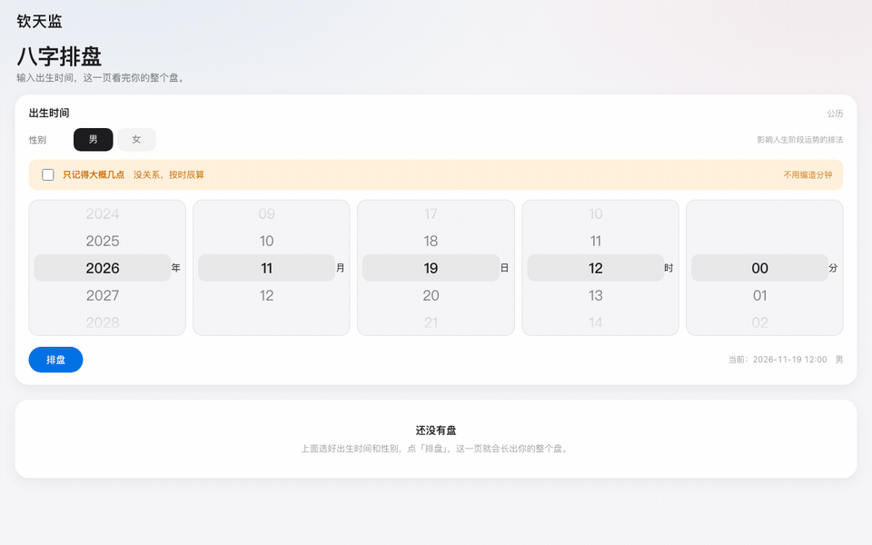

# 钦天监 · 排盘界面

本引擎（`qintianjian`）的**客户界面**：把八字排盘结果做成一面非专业读者能读的界面。零第三方依赖，`python3 ui/serve.py` 直接跑。



> 完整视频：[`media/demo.mp4`](media/demo.mp4)（12 fps / 676 KB）

## 它是什么

一页看完一张盘：**输入出生时间 → 结论 → 四柱 → 五行 → 大运 → 神煞 → 时间口径**。

不是又一个排盘计算器，而是把「引擎算出来的结构」翻译成非专业读者能读的东西，同时**不越界**：
页面只描述命盘结构，不做吉凶断论；涉及传统流派说法的内容明确标注「仅供参考」。

## 跑起来

```bash
# 在仓库根目录执行（serve.py 会自动向上找到 scripts/bazi.py）
python3 ui/serve.py 8901
# → http://127.0.0.1:8901/

# 引擎不在本仓库时，用 QJ_ENGINE 指定
QJ_ENGINE=/path/to/qintianjian python3 ui/serve.py 8901
```

`serve.py` 零依赖（标准库 `http.server` + `ThreadingHTTPServer`），两个职责：静态托管 + `/api/bazi` 调引擎。

| 端点 | 说明 |
|---|---|
| `GET /` | 跳转到排盘页 |
| `GET /api/bazi?date=1990-05-15&hour=11:00&sex=男` | 调 `scripts/bazi.py --json` 并透传 |
| `GET /api/bazi?...&vague=1&shichen=午` | 不确定出生分钟时，改用引擎的 `--shichen`（取该时辰中点） |

页面参数可分享：`?date=&hour=&sex=`，带参打开直接显示该盘。

## 设计决策（以及为什么）

**性别必填。** 大运顺逆由「性别 × 年干阴阳」决定。初版把 `sex` 写死成「男」，所有女性客户拿到错的大运。
修复后实测：同一时间戳，男 → 顺行起运 1997-08-29，女 → **逆行**起运 1993-06-22。

**只有客户层。** 工程证据（引擎版本、测试数、91,676 天历法比对、复现命令、`CLOCK_CHANGE` 日志码）
初版混在产品页面里。审读结论是「两个读者被塞进同一页」，已全部移出。工程内容需要展示时应单独成页。

**单页 + 先填再看。** 输入与结果同页，改任何输入点「排盘」原位刷新，不跳转。
无参进页不自动排盘（严肃使用场景：先填再看）；带参链接则是别人分享的盘，直接显示。

**不确定开关。** 勾「只记得大概几点」后禁用时分轮盘，改用十二时辰选择条。
目的是不让界面给出用户并不拥有的精度。盘面会标注「时柱按此时辰推定」。

**夏令时。** 引擎把 1986–1991 的钟表时还原成标准时（`11:00` → `10:00`）。界面当场说明这次修正，
否则用户会以为排错。

**神煞同名合并。** 不同依据可能重复命中同一神煞（如天乙贵人被日干、年干各引一次），
逐条列像刷屏，已按名称合并、依据用「；」连接。

## 视觉

UI 设计系统来自 `selfmedia-workbench` 的 `dc.css`（原样引入，未修改）。

一页里的层级是刻意做的：

| 层 | 板块 | 手法 |
|---|---|---|
| 主角 | 这张盘在说什么 | 大阴影、19px 主句、唯一视觉焦点 |
| 次主 | 四柱 | 干支 21px，行高加大 |
| 配角 | 五行 / 大运 / 神煞 | 细标题、去阴影、细边框 |
| 背景 | 时间口径 | 一行虚线条 |

## 滚轮实现要点

- 拖拽灵敏度 `DRAG_GAIN = 0.55`（1:1 太跟手，鼠标一抖就飞一格）
- 刻度音用 Web Audio 现场合成：20ms 噪声爆 + 高通 1800Hz + 带通 2400Hz，`TICK_MIN_MS = 26` 节流
- 越过整格才响一声，落定再响一声（更响），不是每个 mousemove 都响
- 尊重 `prefers-reduced-motion`（自动静音 + 关闭入场动画）

## 验证记录

**功能**

- 端到端：无参进页 → 占位 / 排盘 → 全板块渲染 / 改性别 → 重新排盘 / 带参链接直显
- 旧链接 `demo-exact.html?…` 重定向到 picker，参数不丢
- 8 项鲁棒性用例（五行 null / 全 0 / 空、神煞空、十神空、无警告、lunar 空、result 全空）不崩溃
- 8 个宽度（320–1600px）无横向溢出，移动端 390px 轮盘自动折 3+2 行
- 滚轮：拖 100px 过 1 格、跨格音响 2 次（跨格 + 落定）、键盘 ↓↓ 响 2 次

**性能（压测实测）**

| 项 | 结果 |
|---|---|
| 单次排盘（50 次串行） | p50 **119ms**，p99 151ms，0 失败 |
| 并发 10 路 | 单线程时严格排队，末位等 1496ms → 改 `ThreadingHTTPServer` 后墙钟 **334ms** |
| 并发 20 路 | 20/20 成功，墙钟 581ms |
| 吞吐 | 单客户端连续 8.4 req/s，0 失败 |

## 已知限制

- 滚轮**没有惯性滑动**（松手即刻吸附，不是 iOS 的减速曲线）
- 页面文案是通用命理口径，**未过专业内容审核**；神煞含义为通行说法，不同流派差异较大
- `dc.css` 自带对比度问题（`--t3` 约 2.4:1），属共享设计系统，此处未改
- 引擎 120ms/请求的瓶颈在本地进程调用；上百并发需换部署方式

## 目录

```
demo-picker.html      单页排盘（主线）
demo-exact.html       旧链接兼容重定向
index.html            入口
serve.py              零依赖静态服务 + /api/bazi
dc.css                设计系统（原样引入）
media/                demo 录制与截图
```
